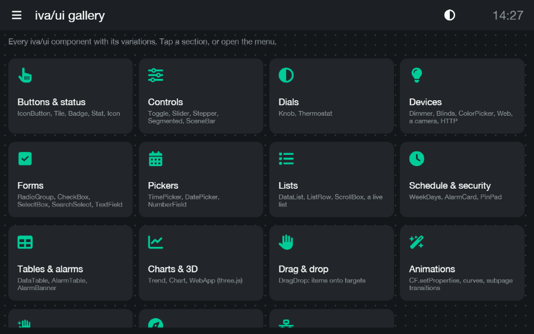
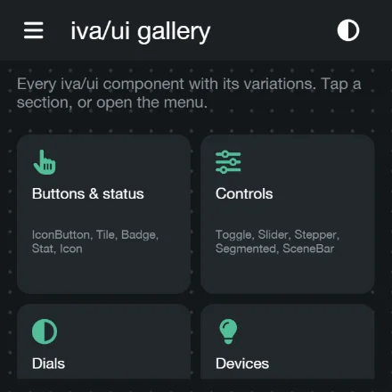
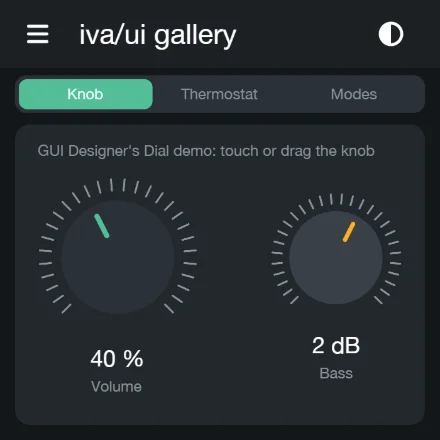

# iva — iViewer assistant

Build [CommandFusion iViewer](https://www.commandfusion.com/) control panels in
JSX. iva compiles them into an ordinary `.gui` (the format GUI Designer
writes), previews them live on a CommandFusion runtime of its own with real
connections to your devices, and comes with a component library, drivers and
a panel app.

<p align="center">
  
</p>

```jsx
// examples/gallery/app.jsx - the GUI above
import Overview from './pages/Overview.jsx';
import Buttons from './pages/Buttons.jsx';
import Controls from './pages/Controls.jsx';
import Dials from './pages/Dials.jsx';
import Devices from './pages/Devices.jsx';
import Forms from './pages/Forms.jsx';
import Pickers from './pages/Pickers.jsx';
import Lists from './pages/Lists.jsx';
import Schedule from './pages/Schedule.jsx';
import Tables from './pages/Tables.jsx';
import Charts from './pages/Charts.jsx';
import DragDrop from './pages/DragDrop.jsx';
import Animations from './pages/Animations.jsx';
import Gestures from './pages/Gestures.jsx';
import Navigation from './pages/Navigation.jsx';
import Network from './pages/Network.jsx';

export default (
  // built at 1280x800, and for phones: a 1400x1400 screen at 3x and a 1080x1920 one (a Nexus 5) at 2.5x, laid
  // out at 467x467 and 432x768 and scaled up by iViewer (as big as on a tablet); the pages lay themselves out from
  // the size (ui.grid) and scroll (ScrollArea)
  <Project name="iva-ui gallery" width={1280} height={800} sizes={['1400x1400@3x', '1080x1920@2.5x']} themes={['dark', 'light']}>
    {Overview}
    {Buttons}
    {Controls}
    {Dials}
    {Devices}
    {Forms}
    {Pickers}
    {Lists}
    {Schedule}
    {Tables}
    {Charts}
    {DragDrop}
    {Animations}
    {Gestures}
    {Navigation}
    {Network}
  </Project>
);
```

```bash
iva create my-panel --template demo   # or blank; --device "iPhone X"; --from Old.gui
cd my-panel
iva dev        # live preview, rebuilds on save; real TCP/UDP/HTTP to the devices
iva check      # what the editor underlines + a test build
iva build      # -> dist/: the .gui, images, scripts, joins.json (--zip: also one .gui.zip)
iva serve      # to iViewer on a real device (GUI File URL http://<this machine>:8019)
iva designer   # build and open it in CommandFusion GUI Designer
```

## Features

- **JSX in, `.gui` out.** Pages, subpages, themes, systems, commands,
  feedbacks, macros, gestures and scripts as JSX elements; what comes out is
  checked against GUI Designer, opens there and runs in iViewer. Editors
  autocomplete every element and prop, with docs on hover and typos
  underlined as you type (`fontSise` → "Did you mean 'fontSize'?").
- **A live preview with real connections.** `iva dev` runs the project in the
  browser on iva's own CommandFusion runtime (Pixi rendering, the `CF.*` API)
  and opens real TCP, UDP, TLS and HTTP connections to your devices. Saving
  rebuilds it.
- **Straight to the panel.** `iva serve` hands the project to iViewer the way
  GUI Designer's Upload Service does, reloads the panel on every save and
  brings its log - `CF.log`, script errors, its servers' traffic - to your
  console.
- **iva/ui**: 46 components - toggles, sliders, steppers, dimmers, blinds,
  knobs, a thermostat, a colour picker, pickers, forms, lists, tables,
  alarms, a PIN pad, a header and side menu, dialogs, trends and charts, drag
  and drop - in dark and light looks switched on the panel at runtime.
- **One project, several screens.** A tablet and a phone build from the same
  JSX, each laid out for its size.
- **Web apps served by the panel itself**: charts (uPlot, Chart.js) and 3D
  (three.js) with live joins.
- **Drivers** for Matter, MQTT and UPnP AV, running in the panel's own
  JavaScript: no server in between.
- **Existing projects in.** `iva decompile` turns any `.gui` into JSX and
  checks the result compiles back to the same `.gui`: all 48 of
  CommandFusion's demos do.
- **iva panel**: an app of its own that runs a `.gui` on iva's runtime, full
  screen - on Android, where iViewer is no longer maintained, and on the
  desktop.

## The gallery

Every iva/ui component with its variations, in [`examples/gallery`](examples/gallery) -
the GUI in the animation above, running in the iva panel app:

```bash
iva dev examples/gallery/app.jsx
```

Its sections: buttons and status, controls, dials, devices, forms, pickers,
lists, schedule and security, tables and alarms, charts and 3D, drag and drop,
animations, gestures, navigation, network - each in a dark and a light look,
switched on the panel at runtime. The same project is also built for a phone
with a square 1400x1400 screen (`<Project sizes={['1400x1400@3x']}>`):

<p align="center">
  
  
</p>

## Getting started

You need [Node.js](https://nodejs.org/) 22 or newer. GUI Designer is optional
(`iva designer`: Windows, or Wine on Linux and macOS).

```bash
git clone https://github.com/shabunin/iva.git
cd iva
npm install
npm link        # puts `iva` on your PATH; or run node bin/iva.mjs from this folder
```

Then `iva create my-panel --template demo` and `iva dev` in it, and open
http://127.0.0.1:5180/.

## A project

`iva create` gives a folder with:

- `app.jsx`: the entry;
- `assets/`: images, found by bare name as iViewer finds them;
- `scripts/`: iViewer JavaScript;
- `iva.d.ts` + `jsconfig.json`: open the folder in VS Code and elements, props
  and their values autocomplete. Your own components' untyped props are
  optional; give them JSDoc types to have them checked too. The types are
  generated from the compiler itself (`iva types` rewrites them);
- `IVA.md`, `IVA-UI.md`, `IVA-WEB.md`, `IVA-DRIVERS.md`: this repository's docs
  (the elements, iva/ui, web apps, drivers), and `AGENTS.md` / `CLAUDE.md`, so
  an AI assistant working in the project has them.

Every element and prop: [docs/components.md](docs/components.md). Build errors
point at the file and line, with "did you mean" for typos.

What iva writes is checked against GUI Designer: themes are laid out the way
Designer writes them (a button's background colour shows in Designer only
with its opacity triple, for one), `font="Helvetica Neue" bold` gets the
device's font name (`HelveticaNeue-Bold`, from Designer's font list), systems
take Designer's defaults per protocol, and `device="iPad Pro 11"` uses
Designer's device sizes.

### The build

`iva build` lays the project out as GUI Designer does with an image folder:

```
dist/
  my-panel.gui          <imagefolder>assets</imagefolder>
  assets/               the project's own images and files (from assets/), and
                        iva's drawings, a folder per component type:
    knobs/volume/         a knob's own folder (named after its label): ticks.png, knob.png
    pickers/lamp/         a colour picker's: wheel.png, marker.png, frame.png
    buttons/              120x44-r12-2b3137.png: size, corner radius, colour
    boxes/ rows/ banners/ sliders/ backgrounds/    (a page's: its name)
    icons/                lightbulb.png - another colour: lightbulb-00bc97.png
    apps/                 web apps (<WebApp>): apps/<name>.js
    sounds/
    scripts/              <script name="scripts/main.js">, iva's scripts (iViewer
                          looks for a .gui's scripts in its image folder)
  joins.json
```

A drawing made twice is one file, named after the first element it's for. In
a build of several looks (`<Project themes>`) a drawing that differs gets the
look's name too: `knobs/volume-light/`, `backgrounds/home-light.png`. Cyrillic
labels are transliterated: `Термостат` makes `knobs/termostat/`.

`<Project folders={false}>` puts everything beside the .gui instead (a
decompiled .gui keeps its own layout this way). `iva build --zip` also writes
`dist/my-panel.gui.zip`: the same files in one archive, a zipped GUI iViewer
loads from a URL.

### Several screens

`<Project sizes={['1920x1080', '1400x1400@3x']}>` builds a GUI per size
(`dist/1920w1080h/`, ...; in the `.zip`, iViewer loads the one for its
screen), the layout made from `screen()`. `@3x` is a phone's dense screen:
laid out at a third of it and scaled up by iViewer, so things are as big as
on a tablet. `--size 1400x1400@3x` builds just that one
([docs/components.md](docs/components.md#screen-sizes)).

## iva/ui

`import { createUi } from 'iva/ui'`: cards, tiles, icon buttons, badges,
stats, toggles, sliders, steppers, segmented controls, scene bars, dimmers,
blinds, dials and a thermostat, a colour picker, radio buttons, checkboxes,
select boxes, text and search fields, time / date / number pickers, lists,
week days, alarms, a PIN pad, a header with breadcrumbs and a clock, a side
menu, dialogs, tables, trends and charts, drag and drop - in a theme, dark
and light switched on the panel at runtime (`<Project themes={['dark', 'light']}>`)
([docs/ui.md](docs/ui.md)).

The gallery's phone build (`1400x1400@3x`, in the preview's GUI picker) puts
its cards one under another, laid out for the width, each page scrolling
(`ui.grid`, `ui.ScrollArea`); lists, pagers, dials and drag & drop go on
screens a tab apart (`ui.Screens`: iViewer scrolls none of them).

Charts and 3D are web apps the panel serves itself: `<WebApp entry="./web/house.js">`
bundles your module (three.js, Chart.js and uPlot come with iva; `iva/web`
talks to the panel's joins) and the panel's own web server - one port for
every app - sends it to a web view ([docs/web.md](docs/web.md)).
`<HttpServer>` is a server of your own, on its own port.

Drivers - a component that brings its systems and script - talk to devices
from the panel itself: Matter (`iva/drivers/matter`), MQTT (`iva/drivers/mqtt`)
and UPnP AV (`iva/drivers/upnp`) ([docs/drivers.md](docs/drivers.md)).

## `iva serve`: on a real device

```bash
iva serve            # app.jsx; or: iva serve Project.gui; or: iva serve dist/ (a folder of GUIs)
```

Serves the project the way GUI Designer's Upload Service does (port 8019,
`/` is the .gui, other files flat by name, Designer's headers), so iViewer
loads it like a project uploaded from Designer: in iViewer's settings, set
the GUI File URL to the address it prints (or scan its `cf://` QR code). The
device has to reach that address: the same network, or the same VPN (a
ZeroTier network, for one).

Saving rebuilds the project, and the panel on the device reloads itself: the
served .gui carries one extra script (`iva-live.js`, only while served by
iva) that waits for the next build, switches the panel's systems off (iViewer
keeps a GUI's sockets past a reload: a server would hold its port from the
next one) and calls `CF.loadGUI`. A `.gui` is re-read when it changes, so a
project saved from GUI Designer reloads too. `--no-live` serves it untouched.
Every request is logged, unknown ones in full (iViewer's cache-complete and
debugger callbacks aren't documented). A folder (`iva serve dist/`) is
served as it is - every file by its path, a page at `/` listing its GUIs -
for GUIs that link to one another (`examples/browse`: one build each in
`dist/<name>/`); no live reload there.

The same script brings the panel's log to the console - `CF.log`, script
errors, what the panel's servers get and send, whether they answer, and what
its web pages meet (their size, their errors) - no remote debugger needed:

```
[iva] panel 10.0.0.7: Javascript starting up. iViewer version: 5.0.7
[iva] panel 10.0.0.7: IvaWeb on 127.0.0.1:8900 (5 s after start): 200 after 40 ms
[iva] panel 10.0.0.7: web /trend_4a5f95be/: loaded, 495x355 dpr 2.5, html 355px
```

On Android, iViewer (5.0.7) starts no system until it's switched off and on -
a remote debugger does that, a plain start doesn't: no TCP client connects, no
server listens. A project with iva's start code (iva/ui, web apps,
`<OnStart>`) does it at start, for every system that hasn't connected.

## iva panel

iViewer for Android isn't maintained any more, and 5.0.7 crashes on Android
16 once a page whose gestures were touched goes away. [panel/](panel/README.md)
is an app of iva's own for the panel instead: the GUI on iva's runtime, full
screen, real sockets from the app (Tauri; an Android APK from CI, and a
desktop build). Give it `iva serve`'s address and it reloads with every build
too; with no server it starts on the gallery, built in.

## `iva decompile`

An existing project (from GUI Designer, or anywhere) into JSX:

```bash
iva decompile "path/to/Project.gui" my-panel
```

`my-panel/` gets `app.jsx`, `themes.jsx`, `systems.jsx`, `pages/*.jsx`,
`subpages/*.jsx`, and the project's images and sounds (`assets/`) and scripts
(`scripts/`). It is checked before it's handed over: decompile compiles it
back, compares it with the original element by element, and fixes what comes
out different. All 48 CommandFusion demos come back as the same `.gui`
(`npm run fixtures`, then `node --import tsx tools/roundtrip.ts fixtures/DemoUserInterfaces`).
Attributes iva doesn't model are kept in `xml={{ ... }}`, elements it doesn't
model (`<timer>`) as `<Raw xml={...} />`.

## `iva dev`

Previews a JSX project, or existing `.gui` files:

```bash
iva dev                                  # app.jsx in this folder
iva dev path/to/project.gui              # or a folder: every .gui in it, with a picker
iva dev http://192.168.0.10:8019/my.gui  # a .gui on a web server
iva dev path/to/my.gui.zip               # a zipped GUI (a .zip with a .gui in it)
```

Open http://127.0.0.1:5180/. Saving a file the project is built from (its .jsx
files and the components it imports, wherever they are, its scripts and
assets) rebuilds it and reloads the page; other files (logs, dist/) don't.
Options: `--port`, `--host 0.0.0.0` (preview from a tablet on the LAN),
`-v` (log sockets).

The toolbar over the panel: reload, landscape / portrait (greyed out when
the GUI has no such layout), outline (element bounds, names on hover), an
FPS box, zoom (−, the zoom: a tap goes between fit and 100 %, +; also
Ctrl+wheel, ⌘/Ctrl +, −, 0) and the hand (drag the view; H, or hold Space;
the middle button drags too), fullscreen. Outline and FPS stay on across
reloads. Ctrl+M hides it.

GUI links (`href="cf://…"`, `CF.loadGUI`) open the GUI they name: the
project's own `.gui` (or `.zip`) of that name, else the URL
([docs/components.md](docs/components.md#gui-linking)). Zipped GUIs load
from their archive, on disk or over HTTP; a folder's `.zip` files with a
`.gui` in them are in the picker too.

### How it works

One Node process serves:

```
browser page                                   Node (iva dev)
──────────────────────────────                 ──────────────────────────────
src/runtime/cf      (parser, Pixi, CF.*, systems)
   │ net / dgram / tls / dns / http
src/runtime/stdlib
   │
src/runtime/host    ── invoke/listen ──────► /__iva/host (WebSocket)
 (sockets, TLS, DNS, HTTP;                      HostSession: node:net, dgram,
  bridge/: the WebSocket)                       tls, dns, http(s)
                                               /__iva/manifest, /__iva/files/…
                                               /__iva/loop/<port>/… (the panel's own servers)
                                               /__iva/remote/… (GUIs on web servers)
```

- **Runtime**: `src/runtime`, iva's own: the CF runtime (`cf/`: the .gui
  parser, Pixi rendering, the `CF.*` API, systems), sockets / UDP / HTTP /
  DNS / TLS (`stdlib/`, `host/`). It started as a copy of
  [agapi](https://github.com/shabunin/agapi)'s cf-runtime (see
  `src/runtime/README.md`); nothing outside iva is needed. What it implements
  of iViewer's API: [docs/cf-api-compatibility.md](docs/cf-api-compatibility.md).
- **Backend**: `src/server/host/session.ts` serves the host commands the
  page's sockets send (`tcp_connect`, `udp_bind`, `tls_connect`,
  `dns_lookup`, …) on Node sockets, plus `http_fetch` (no CORS, self-signed
  certs OK), over one WebSocket (`src/runtime/host/bridge/`). One session per
  page: a reload closes every socket it opened.

Not in the preview's backend: WebSocket servers, and the device's own
settings and keys (brightness, volume, hardware keys - the panel app has
them on Android).

## Repository layout

```
bin/iva.mjs            CLI entry (runs the TypeScript through tsx)
src/cli/               commands
src/compiler/          JSX -> .gui: runtime, components, build, themes, joins, images
src/decompiler/        .gui -> JSX, and the .gui comparison it checks itself with
src/create.ts, check.ts, types.ts, designer.ts   the other commands
src/server/            dev server, project loader, host backend
src/runtime/           the CommandFusion runtime the preview and the panel run (cf/, stdlib/, host/)
src/preview/           the preview page
lib/ui/                iva/ui: the components and their panel script
lib/drivers/           iva/drivers/<name>: a device's component and its panel script
lib/web/               iva/web (a web app's side) and the built-in apps (trend, chart)
panel/                 iva panel: the app (Tauri; Android and desktop)
templates/             iva create's templates (blank, demo) and the files every project gets
docs/                  components, ui, web apps, drivers, CF API compatibility
examples/hello/        a small JSX project
examples/gallery/      every iva/ui component (and examples/elements: shapes, icons)
examples/browse/       GUIs linking to one another
examples/matter/       a Matter controller on the panel (iva/drivers/matter)
examples/mqtt/         an MQTT broker's topics on a page (iva/drivers/mqtt)
examples/upnp/         a UPnP AV control point: servers, renderers, browsing, playback (iva/drivers/upnp)
tools/roundtrip.ts     decompile + compile + compare every .gui under a folder
tools/gen-fonts.ts     src/compiler/fonts.json from GUI Designer's fontlist.xml
test/                  node:test
fixtures/local/        small hand-written .gui projects
fixtures/DemoUserInterfaces/   CommandFusion's demos (npm run fixtures; not committed)
```

## Development

```bash
npm test        # node:test, the whole suite
npm run lint    # tsc, strict, over everything
```

## License

[MIT](LICENSE) © 2026 Vladimir Shabunin

---

CommandFusion, iViewer and GUI Designer are trademarks of CommandFusion. iva
is an independent project, not affiliated with or endorsed by CommandFusion.
