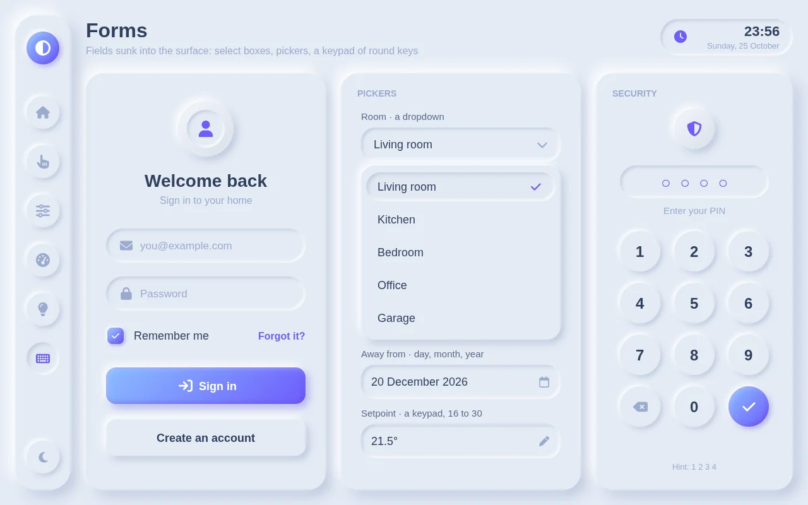
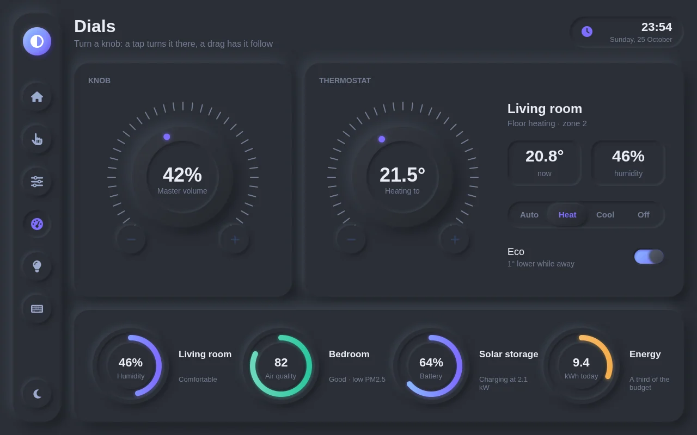
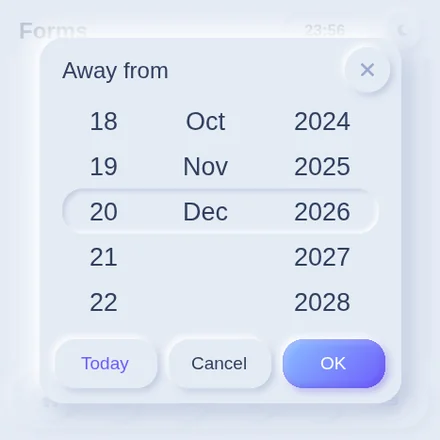
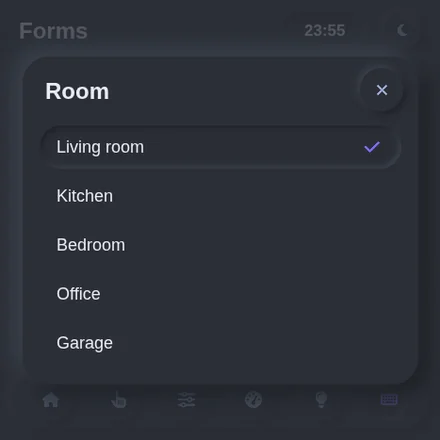

# neomorph

A neumorphic ("soft UI") gallery: every control made of one colour, lit from
the top left - raised shapes catch the light and cast a shadow, sunk ones hold
both inside. Six pages: Overview, Buttons, Controls, Dials, Smart home, Forms
(select boxes, time, date and number pickers, a PIN pad); a light look and a
dark one, switched on the panel; built for a 1280x800 tablet and two phones.

```bash
iva dev examples/neomorph/app.jsx
```

<p align="center">
  
  
</p>

On a phone (`<Project sizes={['1400x1400@3x', '1080x1920@2.5x']}>`): a header,
the cards one under another in a scroll, the sections in a bar at the bottom,
the dials on tabs; every picker opens as a sheet.

<p align="center">
  
  
</p>

## How it's made

- `neu/index.jsx` - the components (`createNeu()`; `ui.js` makes `neu` and
  `t`, the theme): Plate (flat, convex, concave, inset, pressed, accent), Card,
  Button, RoundButton, Chip, Tile, NavCard, Toggle, CheckBox, RadioGroup,
  Segmented, ButtonGroup, Slider, Fader, Progress, Stepper, Knob, Ring, Field,
  PinPad, Select, Scroll. Give one the shape's own x / y / w / h: its shadows
  go round it.
- `neu/paint.js` - iViewer draws no shadows and no gradients, so every soft
  shape is a PNG drawn as the project builds, at the element's own size and
  as sharp as the screen needs (2x on the tablet, 3x and 2.5x on the phones):
  a shape's fill and its outer and inset shadows as CSS box-shadow has them
  (blurred rounded rects in Evan Wallace's closed form). The files go to
  `.neu/`, outside `assets/`, so each size ships only the drawings it uses; a
  rebuild draws only what's new, and `iva build` / `iva check` delete the ones
  no longer used.
- `scripts/neu.js` - the panel side: values as text, one-of-several groups and
  their sliding pill, steppers, the knob, the PIN pad, field hints, the select
  boxes (a row picked on release, never on a drag), the clock.
- The other pickers (search select, time, date, number) are iva/ui's, made
  soft: their logic kept, every flat piece swapped for a raised or sunk one
  (`soften` in `neu/index.jsx`).
- Two looks: colours come from `variant()`. An image with a join of its own
  (it moves: a switch's knob, a segmented pill) is swapped by `Neu.skin`; a
  slider's thumb is the same in both looks (iViewer can't switch it).
- Phones: `components/Stack.jsx` stacks a page's cards in a `neu.Scroll` (a
  list with no join, so the joins in it are the page's own); Dials puts its
  knobs on tabs of subpages, as gestures don't fire in a list.
